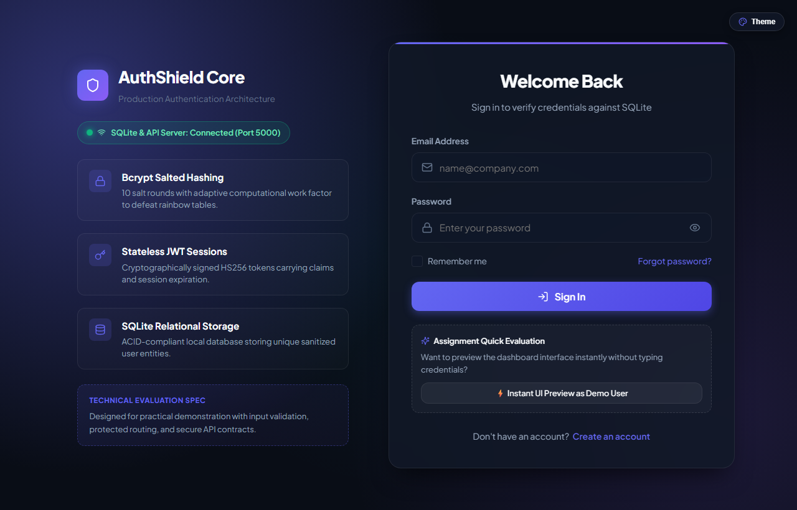
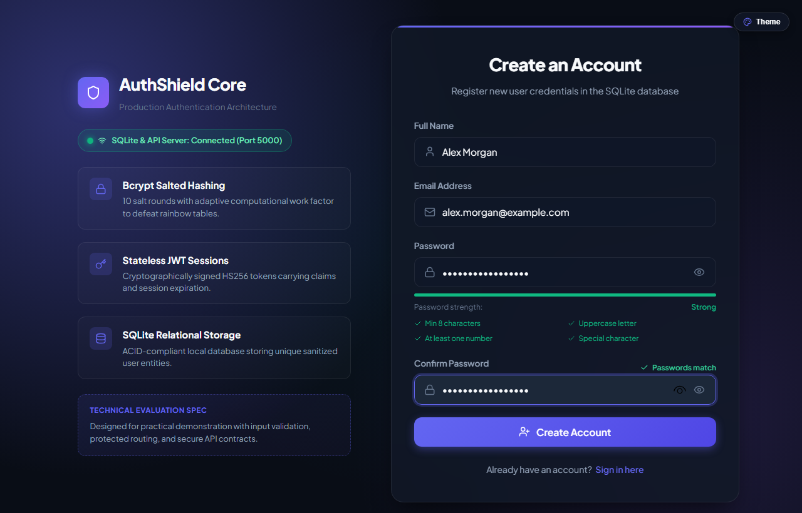
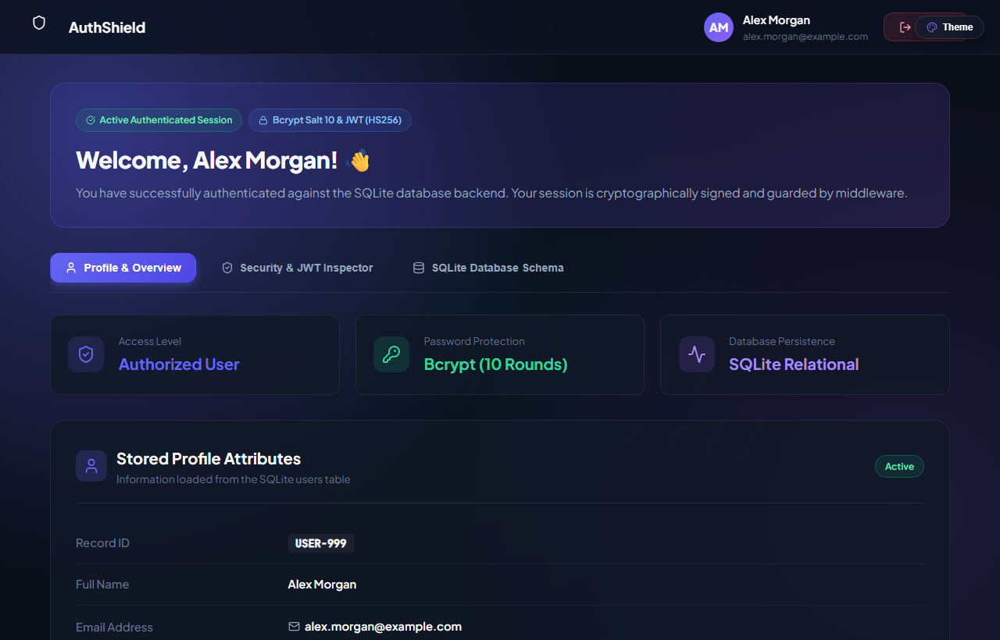
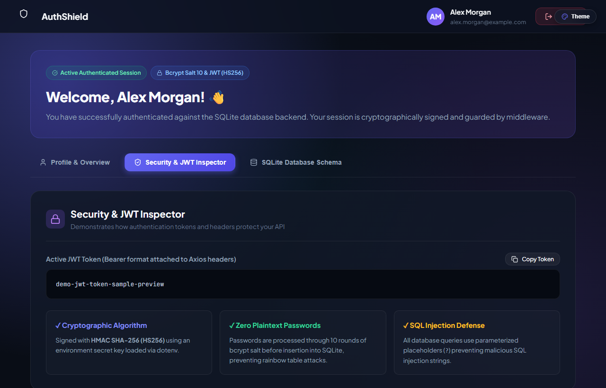
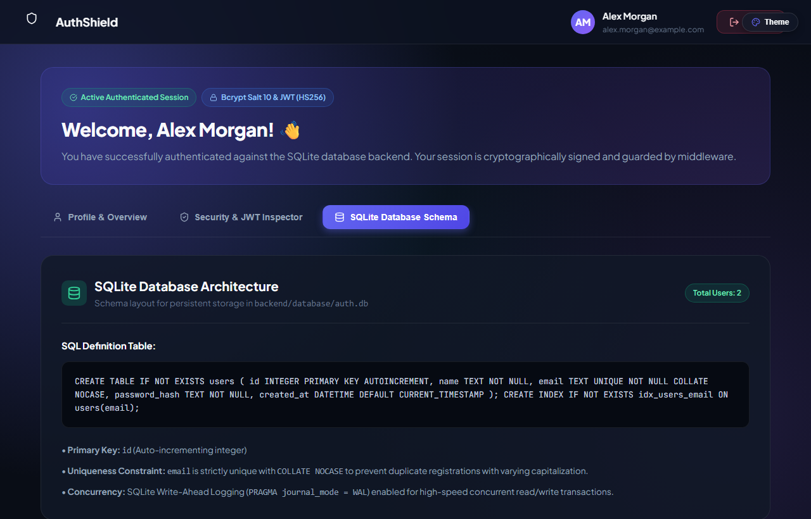

# User Authentication Web Application

A full-stack user authentication system built with **React**, **Node.js**, **Express**, and **SQLite**. This project demonstrates secure user registration, password hashing with Bcrypt, stateless JSON Web Token (JWT) session handling, input validation, and protected frontend routing.

Developed as a college practical technical project and portfolio demonstration.

---

## 📸 Application Screenshots

### 1. Login Page
The login interface includes email and password fields, password visibility toggle, a "Remember me" option, and a live server connection badge.



---

### 2. Registration Page & Real-Time Validation
The registration interface features real-time password strength scoring (evaluating length, casing, numbers, and symbols) and an instant password match indicator.



---

### 3. Dashboard — Profile & Overview
Once authenticated, users are redirected to the protected dashboard displaying their personal profile details loaded from the SQLite database.



---

### 4. Dashboard — Security & JWT Inspector
This tab displays the active JSON Web Token, cryptographic signing algorithm (`HS256`), and security defense mechanisms.



---

### 5. Dashboard — SQLite Database Schema
An architectural view displaying the database table structure, column constraints, and live user count retrieved via API.



---

## 🛠️ Technology Stack

### Frontend
- **React.js 18** (Vite build tool)
- **React Router DOM v6** for client-side routing and protected routes
- **Axios** with request interceptors for attaching Bearer tokens
- **Lucide React** for clean UI icons
- **Vanilla CSS3** with CSS variables, flexbox, grid, and glassmorphism styling

### Backend
- **Node.js** (v18+) runtime environment
- **Express.js** web framework for REST API endpoints
- **SQLite3** relational database engine with Write-Ahead Logging (WAL)
- **bcryptjs** for 10-round salted password hashing
- **jsonwebtoken** for signing and verifying JWT tokens
- **cors** for handling cross-origin requests between frontend and backend
- **dotenv** for environment variable isolation

---

## 🏛️ Project Architecture Diagram

```
┌─────────────────────────────────────────────────────────────┐
│                     Client Browser                          │
│                                                             │
│   [React 18 (Vite) on Port 5173]                            │
│   ├── Pages: Register, Login, Dashboard                     │
│   ├── Route Guard: ProtectedRoute.jsx                       │
│   └── State: AuthContext.jsx                                │
└──────────────────────────────┬──────────────────────────────┘
                               │
                               │ Axios HTTP (Bearer <token>)
                               ▼
┌─────────────────────────────────────────────────────────────┐
│                 Express.js Backend Server                   │
│                     (Port 5000)                             │
│                                                             │
│   ├── CORS & Express JSON Middleware                        │
│   ├── Routes: /api/auth (register, login, me, logout)       │
│   ├── Auth Guard: authMiddleware.js (jwt.verify)            │
│   └── Controller: authController.js                         │
└──────────────────────────────┬──────────────────────────────┘
                               │
                               │ Parameterized SQL Queries (?)
                               ▼
┌─────────────────────────────────────────────────────────────┐
│                    SQLite3 Database                         │
│                  (./database/auth.db)                       │
│                                                             │
│   users table:                                              │
│   ├── id (INTEGER PRIMARY KEY)                              │
│   ├── name (TEXT NOT NULL)                                  │
│   ├── email (TEXT UNIQUE COLLATE NOCASE)                    │
│   ├── password_hash (TEXT NOT NULL - Bcrypt)                │
│   └── created_at (DATETIME)                                 │
└─────────────────────────────────────────────────────────────┘
```

---

## 🚀 Installation & Running Instructions

### Prerequisites
- Node.js installed on your system (version 18 or newer)
- npm (Node Package Manager)

### Step 1: Clone the Repository
```bash
git clone https://github.com/<your-username>/<your-repo-name>.git
cd authentication-system
```

### Step 2: Start the Backend Server
Open a terminal and run:

```bash
cd backend
npm install
npm start
```
The server will start on `http://localhost:5000` and automatically create the SQLite database file at `backend/database/auth.db`.

### Step 3: Start the Frontend Application
Open a second terminal window and run:

```bash
cd frontend
npm install
npm run dev
```
Open your browser and navigate to:
👉 **`http://localhost:5173`**

---

## 📡 API Endpoint Documentation

| Method | Endpoint | Access | Purpose |
| :--- | :--- | :--- | :--- |
| `POST` | `/api/auth/register` | Public | Validates user input, checks for duplicate email, hashes password with Bcrypt, and stores the user in SQLite. |
| `POST` | `/api/auth/login` | Public | Compares submitted password against stored Bcrypt hash; returns a signed JWT if credentials match. |
| `GET` | `/api/auth/me` | Protected | Returns the authenticated user's profile details. Requires `Authorization: Bearer <token>` header. |
| `POST` | `/api/auth/logout` | Public | Terminates the user session. |
| `GET` | `/api/auth/health` | Public | Returns database schema information, table structure, and live user count. |

### Sample Register Request (`POST /api/auth/register`)
```json
{
  "name": "Alex Morgan",
  "email": "alex@example.com",
  "password": "SecurePassword123!"
}
```

### Sample Successful Response (`201 Created`)
```json
{
  "success": true,
  "message": "Account created successfully! Welcome to AuthShield.",
  "user": {
    "id": 1,
    "name": "Alex Morgan",
    "email": "alex@example.com",
    "created_at": "2026-11-11 10:45:32"
  },
  "token": "eyJhbGciOiJIUzI1NiIsInR5cCI6IkpXVCJ9..."
}
```

---

## 🔒 Security Features (Explained Simply)

1. **Password Hashing with Bcrypt**:
   Passwords are never stored in plain text. Before saving to the database, Bcrypt converts the password into an irreversible 60-character hash using a random 10-round salt. Even if the database file is accessed, the real passwords cannot be reversed.
2. **Stateless JWT Authentication**:
   Instead of keeping session states in server memory, the server generates a cryptographically signed token containing the user's ID and email. The client sends this token in request headers. The server verifies the cryptographic signature to confirm authenticity.
3. **Protection Against SQL Injection**:
   All database queries use parameterized placeholders (`?`). User inputs are treated strictly as literal data values rather than executable SQL commands, preventing malicious query manipulation.
4. **Duplicate Email Prevention**:
   Email addresses are normalized to lowercase, and the database enforces a `UNIQUE COLLATE NOCASE` constraint so two users cannot register with variations of the same email.
5. **Protected Frontend Routes**:
   The `ProtectedRoute.jsx` component verifies authentication status before rendering the Dashboard. Unauthenticated users are redirected back to `/login`.
6. **No Leaked Sensitive Information**:
   The password hash is explicitly excluded from API responses and JWT payloads. Failed login attempts return a generic "Invalid email or password" message so attackers cannot guess whether an email exists.

---

## 💡 What I Personally Implemented & Learned

### What I Implemented
- **Full-Stack Authentication Flow**: Engineered the complete journey from user sign-up to session persistence and logout.
- **Dynamic Password Strength Algorithm**: Built a real-time entropy calculation function that evaluates password complexity (length, uppercase, lowercase, numbers, and symbols) and updates progress bars and checklists as the user types.
- **RESTful Architecture**: Created clean Express controllers, centralized route definitions, and unified error-handling middleware.
- **Database Schema & Persistence**: Designed the SQLite table structure with primary keys, uniqueness constraints, and automatic timestamps.
- **Axios Interceptors**: Implemented client-side interceptors to automatically attach Bearer tokens to outgoing requests and catch session timeouts globally.
- **Visual SaaS Interface**: Designed a responsive user interface with glassmorphism, split-screen desktop layouts, and a real-time theme palette switcher.

### Key Learnings & Challenges Solved
1. **Understanding Bcrypt vs Plain Hashing**:
   I learned why standard hashing functions like MD5 or SHA-256 are unsafe for passwords (they are too fast and prone to GPU-based brute-force attacks). Bcrypt's configurable work factor intentionally slows down computation to defeat brute-force and rainbow table attacks.
2. **CORS and Cross-Origin Communication**:
   Connecting a Vite frontend on port `5173` to an Express backend on port `5000` required configuring Cross-Origin Resource Sharing (CORS) headers and handling preflight `OPTIONS` requests properly.
3. **Stateless vs Stateful Sessions**:
   I understood the trade-offs of JWTs versus server-side session tables. JWTs allow stateless horizontal scaling because the server does not need to store active sessions in memory or a shared Redis cache.
4. **Handling Asynchronous SQLite Operations**:
   Because SQLite3 uses traditional Node.js callback functions, I wrapped the database operations in JavaScript Promises (`dbGet`, `dbRun`, `dbAll`) to write clean, readable `async/await` code across all controllers.
